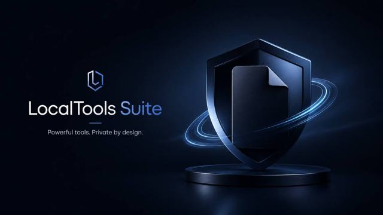
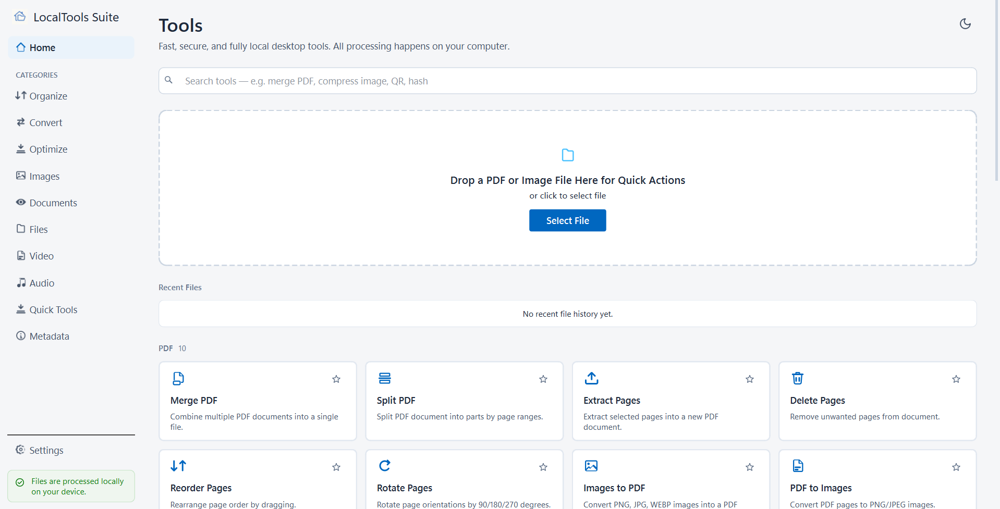
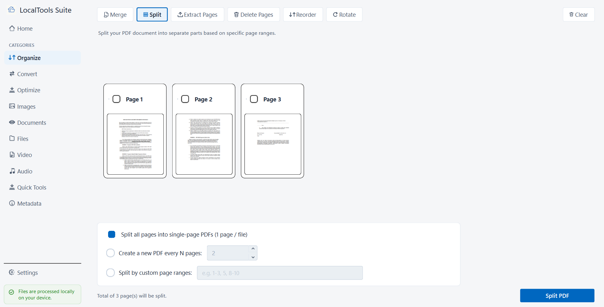
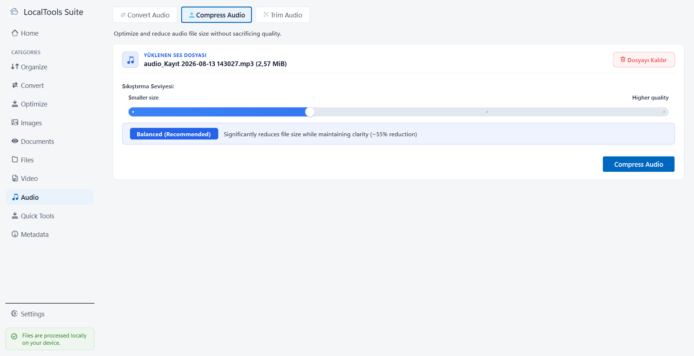
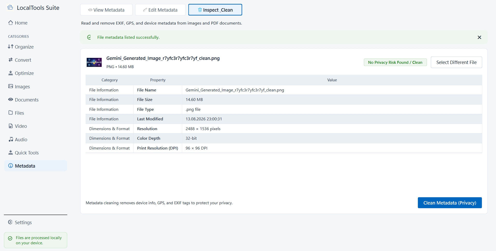

<div align="center">

# LocalTools Suite

### Powerful tools. Private by design.

A privacy-focused Windows desktop utility suite for working with PDFs, images, documents, audio, video, QR codes, file hashes, and metadata — with core file processing performed locally on your device.

[](https://apps.microsoft.com/detail/9P1RLFPFKN6N?hl=tr-tr&gl=TR&ocid=pdpshare)


[Microsoft Store](https://apps.microsoft.com/detail/9P1RLFPFKN6N?hl=tr-tr&gl=TR&ocid=pdpshare) · [Privacy Policy](https://furkanertrk.github.io/localtools-suite/) · [Support](mailto:furkanerturk.dev@gmail.com)

<br>



</div>

---

## About

**LocalTools Suite** is a native Windows desktop application that brings common file utilities together in one focused interface.

Instead of opening a different website for every PDF, image, audio, video, QR, hash, or metadata task, LocalTools Suite keeps these workflows available directly on your PC. The product is designed around a simple principle: **supported file operations should not require uploading your documents or media to an online processing service.**

The application is available publicly on the **Microsoft Store**, and this repository hosts its full source code, tests, documentation, and packaging files.

## Highlights

- **Local-first processing** — supported file workflows run on the user's device; no document upload is required for core tools.
- **One desktop suite** — PDF, image, document, media, QR, hash, and metadata utilities in a single application.
- **No account required** — core tools can be used without creating an account or signing in.
- **Free first release** — no subscription, paid add-on, or in-app purchase in version 4.0.0.
- **English & Turkish UI** — the interface can switch languages without restarting the application.
- **Windows-native distribution** — packaged as x64 MSIX and distributed through the Microsoft Store.
- **Open source** — the project-owned source code is licensed under Apache-2.0; see [License](#license).

## Application screenshots

<table>
  <tr>
    <td align="center"><strong>Home</strong></td>
    <td align="center"><strong>PDF Organizer</strong></td>
  </tr>
  <tr>
    <td></td>
    <td></td>
  </tr>
  <tr>
    <td align="center"><strong>Audio Tools</strong></td>
    <td align="center"><strong>Metadata Tools</strong></td>
  </tr>
  <tr>
    <td></td>
    <td></td>
  </tr>
</table>

## Features

The 4.0.0 release contains 26 enabled tools:

| Area | Included tools |
| --- | --- |
| **PDF Organize** | Merge, split, extract pages, delete pages, reorder pages, rotate pages |
| **PDF Convert** | Images → PDF, PDF → Images, PDF → Text |
| **PDF Optimize & Metadata** | Compress PDF, view/edit PDF metadata |
| **Images** | Convert image formats, compress images |
| **Documents & ID** | A4 ID-card copy sheets, passport/biometric photo sheets |
| **File Utilities** | Calculate and verify MD5, SHA-1, SHA-256, and SHA-512 hashes |
| **QR & Metadata** | Generate QR codes, read QR codes from images, inspect and clean supported file metadata |
| **Video** | Compress video, video → GIF, extract audio, trim video |
| **Audio** | Convert audio, compress audio, trim audio |

### Not part of 4.0.0

The following capabilities are intentionally absent and are not represented as
available features: OCR, cloud processing, user accounts, digital signatures,
adding or removing PDF passwords, PDF-to-Word/Excel conversion, batch renaming,
duplicate detection and file-system analysis.

## Privacy by design

LocalTools Suite is built for workflows where files may contain private or sensitive information. The application has no publisher-operated document-processing backend.

- Selected documents and media are processed locally for supported operations.
- Core tools do not require an account or an internet connection.
- The application is not designed to upload documents, extracted text, or media, and no telemetry is designed to collect document contents.
- Logs are designed to avoid document contents, extracted text, passwords, and unnecessary sensitive metadata.
- Settings, favorites, and the optional recent-file history remain in the local user profile; users control which files are opened and where outputs are written.
- Opening a URL decoded from a QR code is an explicit action that hands the URL to the default browser; the destination is outside LocalTools Suite.

For details about local preferences, recent-file history, temporary files, logs, retention, and user controls, see the full **[Privacy Policy](https://furkanertrk.github.io/localtools-suite/)**.

## Engineering

LocalTools Suite was developed as a production-oriented Windows desktop application rather than a demo project.

### Technology

- **C++20 / Qt 6 Widgets** for the native desktop application and UI (Core, Gui, Widgets, Concurrent, Svg, Multimedia, and MultimediaWidgets)
- **PDFium 153.0.7999.0** for PDF rendering and document operations
- **FFmpeg 8.1 (LGPL)** standalone executables, invoked as child processes, for local audio/video processing
- **qrcodegen / quirc** for QR generation and decoding
- **CMake and Ninja** for the build; **MSIX** for Windows packaging and Microsoft Store distribution
- Asynchronous worker architecture: long-running PDF, image, and media operations run through background jobs so the interface remains responsive

`Qt6Network.dll` appears in the packaged runtime because Qt Multimedia pulls it
in transitively. The application source does not implement document upload or a
publisher backend.

### Release engineering and verification

The 4.0.0 release candidate went through a documented hardening and evidence process, and the product is published on the Microsoft Store. In this repository:

- The suite contains **34 automated CTest cases**; a clean-clone Debug build and full CTest run recorded on 2026-10-23 passed 34/34, including a 24-case UI matrix (DPI 100/125/150/200 × system/light/dark themes × en/tr).
- `resources/translations/tr_TR.ts` currently has **714 finished translation entries** with no unfinished or vanished entries, and `translation_catalog_test` enforces that completeness.

## Requirements

- **Windows 10 version 1809 (build 17763) or later**
- **Windows 11** supported
- **x64** architecture
- At least 1 GB of free disk space is recommended for tools that create intermediate files

Windows 7, Windows 8, and Windows 8.1 are not supported by the Store release.

## Install

The recommended installation method is the Microsoft Store:

### [Download LocalTools Suite from Microsoft Store](https://apps.microsoft.com/detail/9P1RLFPFKN6N?hl=tr-tr&gl=TR&ocid=pdpshare)

To build and run the application from this repository instead, see [Build from source](#build-from-source).

## Current release

**LocalTools Suite 4.0.0** is the first public Microsoft Store release. It is free, supports English and Turkish, and requires no account or in-app purchase for the released tools.

The initial release focuses on reliable local file tooling, privacy, localization, packaging quality, and a polished Windows desktop experience rather than cloud accounts or online processing. This source tree contains the 26 enabled tools represented by the published release.

## Repository layout

This repository contains the full project:

- `src/` — application source code (C++20 / Qt 6)
- `tests/` — automated test executables registered with CTest
- `CMakeLists.txt` — CMake build definition
- `resources/` — application resources, including `resources/translations/` (English and Turkish catalogs)
- `docs/` — documentation, including the FFmpeg and PDFium compliance notes and `docs/images/` (cover image and screenshots used by this README)
- `tools/` — build and release helper scripts (for example `tools/fetch_ffmpeg.ps1`)
- `packaging/` — MSIX packaging files for the Microsoft Store release
- `legal/` — third-party license texts and notices
- `third_party/` — location for locally provisioned third-party runtimes (see [`BUILD.md`](BUILD.md))
- `index.html` — the source page served as the public [privacy policy](https://furkanertrk.github.io/localtools-suite/)
- [`BUILD.md`](BUILD.md), [`CONTRIBUTING.md`](CONTRIBUTING.md), [`SECURITY.md`](SECURITY.md), [`THIRD_PARTY_NOTICES.md`](THIRD_PARTY_NOTICES.md), [`LICENSE`](LICENSE), [`NOTICE`](NOTICE)

The project-owned source code is licensed under the [Apache License, Version 2.0](LICENSE); third-party components keep their own licenses.

## Architecture

```text
Qt Widgets UI
      |
      v
Application / Services
      |
      v
Tool Registry + Job Queue
      |
      v
Focused Operations
      |
      v
Backends
  ├── PDFium
  ├── Qt imaging and PDF rendering
  ├── qrcodegen and quirc
  ├── standalone FFmpeg child processes
  └── Windows Media Foundation playback
```

The UI does not call PDFium directly. Long-running PDF, image and media operations
run through asynchronous workers or background jobs so the interface remains
responsive.

## Build from source

Development requires Qt 6.11.1 Community with the MinGW 64-bit toolchain, CMake,
Ninja and separately provisioned PDFium/FFmpeg runtimes. The complete
clean-build procedure is documented in [`BUILD.md`](BUILD.md).

```powershell
# 1. Provision PDFium into third_party/pdfium (see BUILD.md for checksums).
# 2. Fetch the pinned LGPL FFmpeg runtime.
.\tools\fetch_ffmpeg.ps1

# 3. Configure and build a Debug development tree.
cmake -B build-debug -G Ninja `
    -DCMAKE_BUILD_TYPE=Debug `
    -DCMAKE_PREFIX_PATH="$env:QT_ROOT"

cmake --build build-debug
ctest --test-dir build-debug --output-on-failure
```

> **Clean-clone caveat:** the CMake project requires PDFium before configure and
> the pinned FFmpeg runtime before Release builds. The required binaries are not
> committed. `BUILD.md` lists exact versions, checksums and unresolved build
> limitations.

## Testing

The repository registers **34 CTest cases**: ten functional suites (including
the 26-tool smoke test, localization, logging-privacy, output-safety,
job-cancellation and media-runtime checks) plus a **24-case UI matrix** covering
DPI scaling 100/125/150/200 × system/light/dark themes × en/tr languages.

A clean-clone Debug build and full CTest run recorded on 2026-10-23 passed
**34/34**. Continuous integration is not configured for this repository; run
the suite locally as shown above.

Localization completeness is enforced by `translation_catalog_test`:
`resources/translations/tr_TR.ts` currently has 714 finished entries and no
unfinished or vanished entries.

## Third-party components

Qt, PDFium, FFmpeg, qrcodegen, quirc and compiler runtimes remain under their own
licenses. See [`THIRD_PARTY_NOTICES.md`](THIRD_PARTY_NOTICES.md),
[`legal/THIRD_PARTY_NOTICES.txt`](legal/THIRD_PARTY_NOTICES.txt),
[`docs/FFMPEG_COMPLIANCE.md`](docs/FFMPEG_COMPLIANCE.md) and
[`docs/PDFIUM_COMPLIANCE.md`](docs/PDFIUM_COMPLIANCE.md).

## License

LocalTools Suite's project-owned source code is licensed under the
[Apache License, Version 2.0](LICENSE). The canonical license text is in the
repository's `LICENSE` file; the required attributions are in the `NOTICE` file,
which must be preserved in redistributed derivative works (Apache-2.0 §4(d)).
Third-party components are not relicensed by this repository and remain governed
by their respective licenses.

The published Microsoft Store binary remains distributed under the Store listing
and its end-user terms; the source license above governs the source in this
repository.

## Contributing and security

- See [`CONTRIBUTING.md`](CONTRIBUTING.md) for build, test and contribution rules.
- Report security issues privately through the repository's security-advisory
  channel or the contact in [`SECURITY.md`](SECURITY.md).

## Support

For product support, bug reports, or privacy-related questions:

**furkanerturk.dev@gmail.com**

## Author

Developed and published by **Furkan Ertürk**.

---

<div align="center">

**LocalTools Suite — useful file tools, without turning your files into uploads.**

</div>
